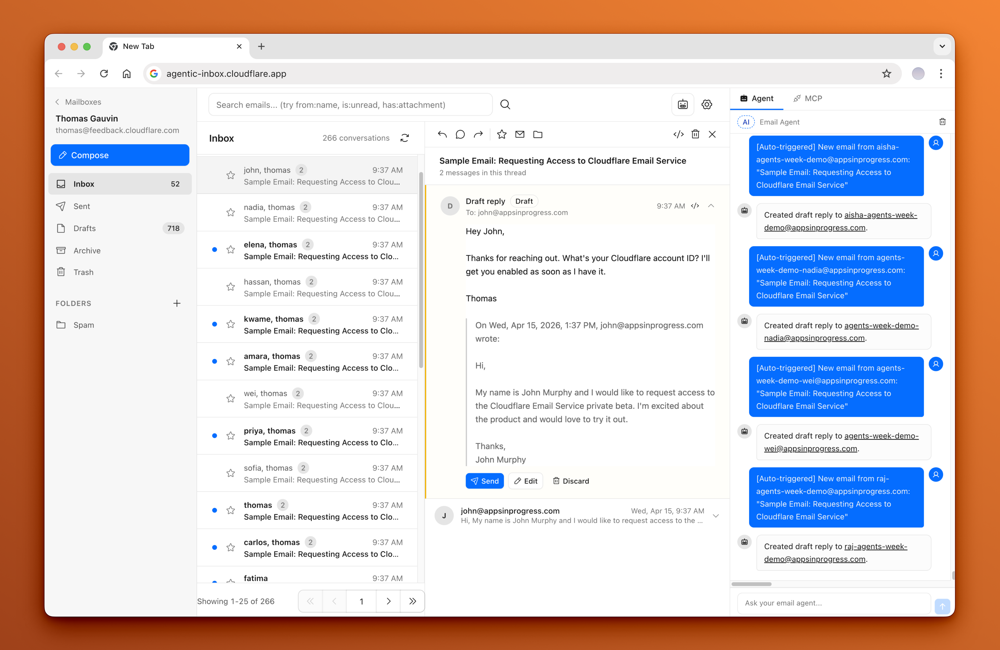

<div align="center">
  <h1>Agentic Inbox</h1>
  <p><em>A self-hosted email client with an AI agent, running entirely on Cloudflare Workers</em></p>
</div>

This repository is a fork of [Cloudflare's Agentic Inbox](https://github.com/cloudflare/agentic-inbox), maintained by Aaron212 with additional features and changes.

Agentic Inbox lets you send, receive, and manage emails through a modern web interface -- all powered by your own Cloudflare account. Incoming emails arrive via [Cloudflare Email Routing](https://developers.cloudflare.com/email-routing/), each mailbox is isolated in its own [Durable Object](https://developers.cloudflare.com/durable-objects/) with a SQLite database, and attachments are stored in [R2](https://developers.cloudflare.com/r2/).

An **AI-powered Email Agent** can read your inbox, search conversations, and draft replies -- built with the [Cloudflare Agents SDK](https://developers.cloudflare.com/agents/) and [Workers AI](https://developers.cloudflare.com/workers-ai/).



Read the blog post to learn more about Cloudflare Email Service and how to use it with the Agents SDK, MCP, and from the Wrangler CLI: [Email for Agents](https://blog.cloudflare.com/email-for-agents/).

## How to setup

**Important**: Clicking the 'Deploy to Cloudflare' button is only one part of the setup. You must follow the **After deploying** steps as well. For a full step-by-step guide with screenshots, refer to this comment:
https://github.com/cloudflare/agentic-inbox/issues/4#issuecomment-4269118513

### To set up

1. Deploy to Cloudflare. The deploy flow will automatically provision R2, Durable Objects, and Workers AI. You'll be prompted for **DOMAINS**, which is the domain (yourdomain.com) you want to receive emails for (email@yourdomain.com).

   [](https://deploy.workers.cloudflare.com/?url=https://github.com/Aaron-212/agentic-inbox)

2. **Configure Cloudflare Access** -- Enable [one-click Cloudflare Access](https://developers.cloudflare.com/changelog/post/2025-10-03-one-click-access-for-workers/) on your Worker under Settings > Domains & Routes. The modal will show your `POLICY_AUD` and `TEAM_DOMAIN` values. `TEAM_DOMAIN` can be either your Access team URL or the full `.../cdn-cgi/access/certs` URL. **You must set these as secrets for your Worker.**
3. **Set up Email Routing** -- In the Cloudflare dashboard, go to your domain > Email Routing and create a catch-all rule that forwards to this Worker
4. **Enable Email Service** -- The worker needs the `send_email` binding to send outbound emails. See [Email Service docs](https://developers.cloudflare.com/email-routing/email-workers/send-email-workers/)
5. **Create a mailbox** -- Visit your deployed app and create a mailbox for any address on your domain (e.g. `hello@example.com`)

### Troubleshooting Access

1. If you see `Invalid or expired Access token`, that usually means `POLICY_AUD` or `TEAM_DOMAIN` secrets are incorrect.
   - Resolution: [turn Access off and back on for the Worker to get the Access modal again](https://developers.cloudflare.com/changelog/post/2025-10-03-one-click-access-for-workers/), then reset your Worker secrets to the latest `POLICY_AUD` and `TEAM_DOMAIN` values shown there.
2. If you see `Cloudflare Access must be configured in production`, this application is intentionally enforcing Cloudflare Access so your inbox is not exposed to anyone on the internet.
   - Resolution: enable Access using [one-click Cloudflare Access for Workers](https://developers.cloudflare.com/changelog/post/2025-10-03-one-click-access-for-workers/), then set the `POLICY_AUD` and `TEAM_DOMAIN` Worker secrets from the modal values.

## Features

- **Full email client** — Send and receive emails via Cloudflare Email Routing with a rich text composer, reply/forward threading, folder organization, search, and attachments
- **Per-mailbox isolation** — Each mailbox runs in its own Durable Object with SQLite storage and R2 for attachments
- **Built-in AI agent** — Side panel with 9 email tools for reading, searching, drafting, and sending
- **On-demand AI drafts** — Click "Draft an AI reply" next to Reply to generate a draft for review, or ask the agent in the side panel. Incoming emails do not trigger reply generation; you review and send drafts from the UI
- **Configurable and persistent** — Custom system prompts per mailbox, persistent chat history, streaming markdown responses, and tool call visibility

## Stack

- **Frontend:** React 19, React Router v7, Tailwind CSS, Zustand, TipTap, `@cloudflare/kumo`
- **Backend:** Hono, Cloudflare Workers, Durable Objects (SQLite), R2, Email Routing
- **AI Agent:** Cloudflare Agents SDK (`AIChatAgent`), AI SDK v6, Workers AI (`@cf/moonshotai/kimi-k2.5`), `react-markdown` + `remark-gfm`
- **Auth:** Cloudflare Access JWT validation (required outside local development)

## Getting Started

Install Node.js 26 and pnpm 12 with [mise](https://mise.jdx.dev/), then start the development server:

```bash
mise install
mise exec -- pnpm install
mise exec -- pnpm run dev
```

### Translations

Use the language selector in the mailbox list or inbox header to choose English or Simplified Chinese. The app saves
that choice in a cookie and reloads the page. On your first visit, it detects a supported browser language and falls
back to English.

To update UI translations, edit `messages/en.json` and `messages/zh-CN.json` with matching keys and interpolation
parameters. Keep plural rules in the catalogs. Paraglide generates typed message functions in `shared/paraglide/`;
edit the catalogs rather than the generated files. Email bodies, custom folder names, and protocol identifiers retain
their original content.

The Vite plugin regenerates messages during development. To regenerate them separately, run:

```bash
mise exec -- pnpm run i18n:compile
```

Run `mise exec -- pnpm run typecheck` to check message calls along with the application types. Locale strategies and
cookie settings are configured in `project.inlang/paraglide.config.ts`.

### Configuration

1. Set your domain in `wrangler.jsonc`
2. Create an R2 bucket named `agentic-inbox`: `wrangler r2 bucket create agentic-inbox`

### Deploy

Before your first deployment with delivery tracking, create the delivery queue and its dead-letter queue:

```bash
mise exec -- pnpm exec wrangler queues create agentic-inbox-delivery
mise exec -- pnpm exec wrangler queues create agentic-inbox-delivery-dlq
```

Deploy to Cloudflare:

```bash
mise exec -- pnpm run deploy
```

### Track email delivery

To receive delivery updates, configure an [Email Sending event subscription](https://developers.cloudflare.com/email-service/reference/event-subscriptions/)
for each domain or subdomain you send from:

1. In the Cloudflare dashboard, open **Queues** and select `agentic-inbox-delivery`.
2. Open **Subscriptions** and select **Subscribe to events**.
3. Select the Email Sending source and your sending domain. Subscribe to `message.delivered`, `message.deferred`,
   `message.bounced`, `message.failed`, `message.rejected`, and `message.complained`.
4. Save the subscription. Repeat for each additional sending domain or subdomain.
5. Send an email from the app and open its message in **Sent**. Expand the delivery status to inspect each recipient's
   outcome, server response, and Cloudflare message ID. Compare it with the Email Service **Activity log**.

The app reports immediate submission errors in the composer and keeps the draft. Accepted submissions appear as
**Queued for delivery** until delivery events arrive. Without the subscription, messages remain queued in the app even
if Cloudflare has delivered them. Messages sent before delivery tracking was enabled have no tracked status.

Delivery updates distinguish temporary delays, permanent bounces, rejections, internal failures, and spam complaints.
The message view refreshes pending outcomes every 15 seconds while open. Acceptance by the recipient's mail server
doesn't confirm inbox placement or that the recipient read the email.

If a request times out or its outcome can't be confirmed, check **Sent** and Cloudflare's **Activity log** before
retrying to avoid sending a duplicate. Submission failures are also retained in **Sent** with their error details.
Agent and MCP sends use the same tracking and return `accepted` after provider acceptance.

Queue processing retries failed events up to 10 times, then moves them to `agentic-inbox-delivery-dlq` for inspection.
Duplicate events are safe to replay, and nonterminal events cannot overwrite a terminal delivery outcome. Events that
arrive before the provider message ID is stored are matched when the send completes. The daily cleanup removes
unmatched delivery records older than 30 days.

## Prerequisites

- Cloudflare account with a domain
- [Email Routing](https://developers.cloudflare.com/email-routing/) enabled for receiving
- [Email Service](https://developers.cloudflare.com/email-service/) enabled for sending
- [Workers AI](https://developers.cloudflare.com/workers-ai/) enabled (for the agent)
- [Cloudflare Access](https://developers.cloudflare.com/cloudflare-one/policies/access/) configured for deployed/shared environments (required in production)

Any user who passes the shared Cloudflare Access policy can access all mailboxes in this app by design. This includes the MCP server at `/mcp` -- external AI tools (Claude Code, Cursor, etc.) connected via MCP can operate on any mailbox by passing a `mailboxId` parameter. There is no per-mailbox authorization; the Cloudflare Access policy is the single trust boundary.

## Architecture

```
┌──────────────┐     ┌──────────────────┐     ┌─────────────────┐
│   Browser    │────>│  Hono Worker     │────>│  MailboxDO      │
│  React SPA   │     │  (API + SSR)     │     │  (SQLite + R2)  │
│  Agent Panel │     │                  │     └─────────────────┘
└──────┬───────┘     │  /agents/* ──────┼────>┌─────────────────┐
       │             │                  │     │  EmailAgent DO  │
       │ WebSocket   │                  │     │  (AIChatAgent)  │
       └─────────────┤                  │     │  9 email tools  │
                     │                  │────>│  Workers AI     │
                     └──────────────────┘     └─────────────────┘
```

## License

Apache 2.0 -- see [LICENSE](LICENSE).
